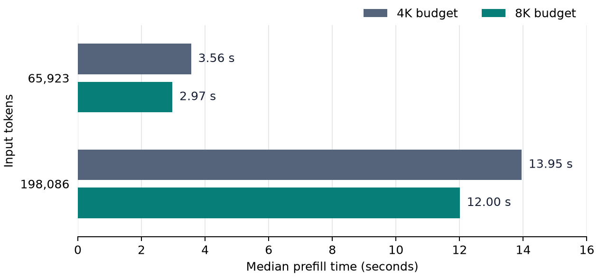

# 4K 与 8K Prefill 批 token 预算短测

这次先验证能否用更大的批 token 预算缩短 P 处理长输入的时间，再选定 64K 长会话实验的 P 端配置。

## 怎么测

2026 年 11 月 26 日，使用单个 P 实例、4 张 Ascend 910B2、Qwen3.5-35B-A3B BF16、Attention TP4 和 Expert EP4。选两个固定输入，分别为 65,923 和 198,086 token。每个预算单独启动、预热，并把该预算纳入图捕获尺寸。计时请求串行发送，每条更换 cache salt，校验缓存命中为零、输入全量计算。每种输入和每档预算各重复三次，每次输出 1 个 token。共 12 条计时请求。

Prefill 用时按首个计算分块派发到最后一个分块就绪计算，入口排队单列。两档的满分块都走 `PIECEWISE` 图。

## 结果

| 输入 token | 4K Prefill 中位耗时 | 8K Prefill 中位耗时 | 耗时变化 | 分块数（4K → 8K） |
| ---: | ---: | ---: | ---: | ---: |
| 65,923 | 3.56 秒 | 2.97 秒 | −16.5% | 17 → 9 |
| 198,086 | 13.95 秒 | 12.00 秒 | −13.9% | 50 → 26 |

较大的分块单步更久，但总步数减少，两个输入的 Prefill 都更快。下一步把 8K 和对应的图捕获尺寸用到 P 端，再在原生 2P2D 长会话中测 TTFT 和吞吐。本次数据覆盖单 P 的冷输入处理，正式计划中的 MatmulAllReduce、TP2、跨机交接和真实并发需要按主实验的实际记录来解释。 [64K 长会话实验计划](../../docs/terminal-64k-natural-repeat-plan.md)

公开表包含 12 条请求的计时和图模式。原始事件留在 CPU 容器私有归档。 [逐请求数据](request-timings.csv)
