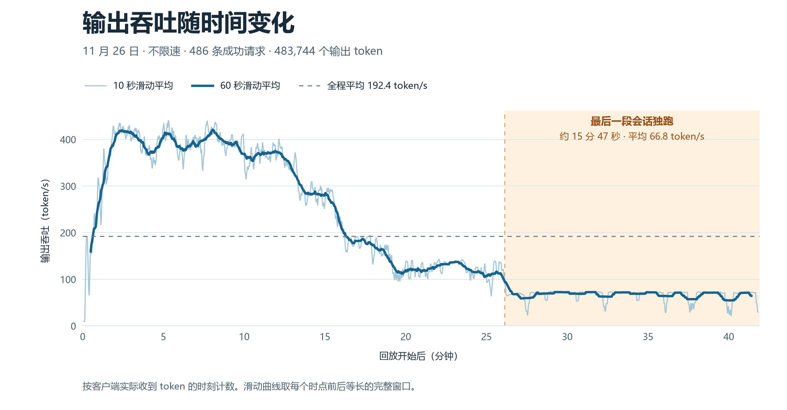
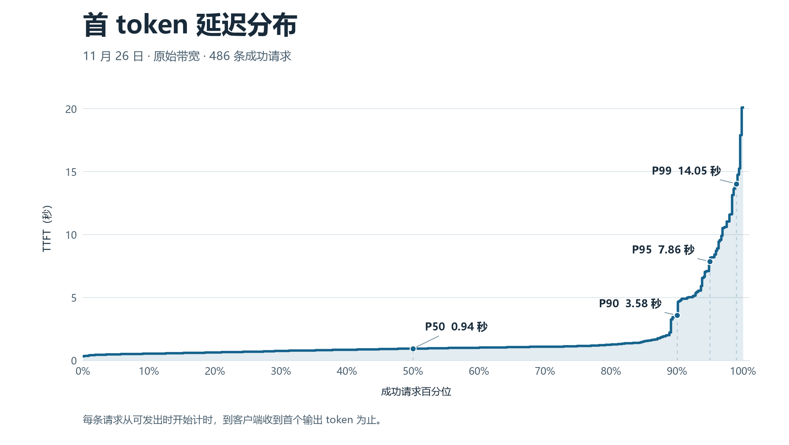
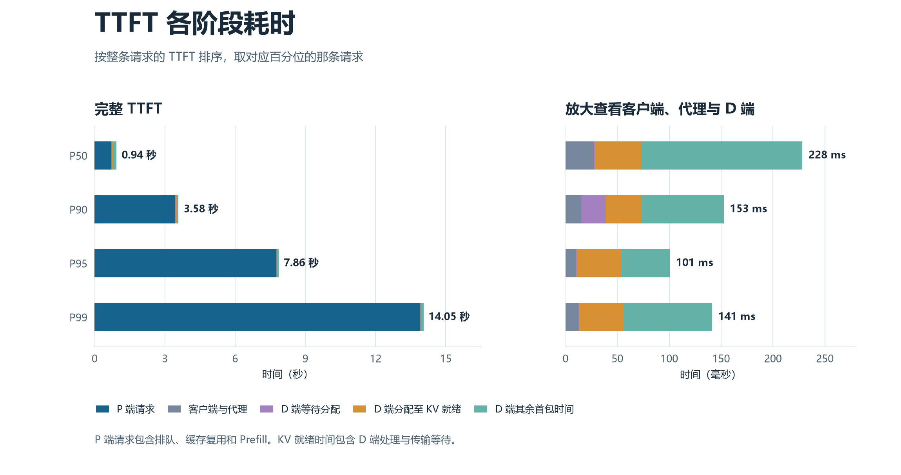

# Terminal-Bench 64K 原始带宽回放

2026 年 11 月 26 日，在双机各四卡 910B2 上回放 10 段 Terminal-Bench 会话，每段从第一条模型调用开始。部署为原生 2P2D，每实例 TP2/EP2，模型为 Qwen3.5-35B-A3B BF16。P 端每批最多 8,192 token，开启 MatmulAllReduce，双侧启用本地 APC，每侧共享 Store 容量为 64 GiB。会话起点按平均 0.5 个新会话/秒采样，10 段在 27.13 秒内进场。后继等前驱结束和工具间隔，输出按自然 EOS 或逐请求上限停止。两端各四个实验口的原始出站读回均为 200 Gbps/口。 [原始负载及部署](../../docs/terminal-64k-natural-repeat-plan.md)

## 结果

一轮共计划 516 条，486 条成功，1 条在 D 响应开始前遇到 HTTP 读取错误，29 条后继按依赖跳过。成功请求共生成 **483,744 token**，从首条计划投放到最后完成用时 **2,514.05 秒（41 分 54 秒）**，成功输出按实际时长折算为 **192.4 token/s**。第 5–10 分钟的实测输出为 **397.0 token/s**。这一轮提供原始带宽下的诊断和时序数据，完整负载的正式吞吐需 516 条都完成。 [逐请求数据](request-timings.csv)

成功请求的 TTFT P50、P90、P95、P99 是 **0.94、3.58、7.86、14.05 秒**。486 条中有 32 条从代理发给 P 到首次调度至少用 1 秒，全部在前 89 秒发往 P。第 5 分钟以后，这段时间的 P95 约 60–66 毫秒。vLLM 从请求进入调度器队列到首次调度的累计时间约 13 毫秒，代理到首次调度的几秒等待还覆盖 API、引擎取请求和调度过程中执行的操作。样本 P95 请求中，首次调度前约 2.74 秒，首次调度至 P 准备好交接约 5.01 秒，D 从分配接收空间至 KV 就绪约 43 毫秒。

## 各会话何时结束

结束时刻从整轮首条计划投放起算。TTFT、首 token 后耗时和轮间间隔均在同一会话内逐轮相加。会话自首条可投放起的持续时间等于这三项加上失败请求耗时。首 token 后耗时按客户端从收到首 token 到该轮完成计量，包含生成和流式返回。

| 会话 | 结束时刻 | 成功轮数 | 输出 token | 累计 TTFT | 首 token 后 | 轮间间隔 | 结束早晚的主要原因 |
| --- | ---: | ---: | ---: | ---: | ---: | ---: | --- |
| `path-tracing` | 1:32（中断） | 4/34 | 1,885 | 36.0 秒 | 31.1 秒 | 10.3 秒 | 第 5 个实验请求在 D 读响应失败，另用约 5.0 秒，后续 29 轮跳过 |
| `financial-document-processor` | 9:21 | 63 | 16,820 | 115.8 秒 | 298.9 秒 | 144.5 秒 | 完整会话中输出最少，轮数多使间隔累计较长 |
| `extract-moves-from-video` | 12:24 | 72 | 25,346 | 114.5 秒 | 472.1 秒 | 157.5 秒 | 轮数多，每轮输出总体较短 |
| `video-processing` | 13:15 | 40 | 34,358 | 71.5 秒 | 621.3 秒 | 78.2 秒 | 轮数较少，生成占约八成 |
| `regex-chess` | 15:44 | 32 | 44,469 | 44.1 秒 | 811.4 秒 | 67.7 秒 | 完整会话中轮数最少，每轮输出较多 |
| `path-tracing-reverse` | 15:47 | 42 | 41,775 | 79.6 秒 | 762.0 秒 | 86.8 秒 | 生成时间为主，3 轮达到输出上限 |
| `make-doom-for-mips` | 16:08 | 74 | 37,137 | 116.5 秒 | 675.0 秒 | 172.4 秒 | 轮数最多，轮间等待累计最长 |
| `gcode-to-text` | 19:09 | 55 | 51,526 | 102.6 秒 | 927.4 秒 | 115.6 秒 | 输出超过 5 万 token，生成占约八成 |
| `winning-avg-corewars` | 26:07 | 51 | 81,326 | 54.0 秒 | 1,385.9 秒 | 100.3 秒 | 输出量第二，7 轮达到输出上限 |
| `make-mips-interpreter` | 41:54 | 53 | 149,102 | 86.6 秒 | 2,299.9 秒 | 118.2 秒 | 输出量最大，11 轮达到输出上限 |

`make-mips-interpreter` 一段会话输出了整轮约 31% 的 token。它开始后到结束约 41 分 45 秒，其中首 token 后约 **38 分 20 秒（92%）**，P HTTP 累计约 **72 秒**，已包含在 86.6 秒 TTFT 内。最后两段会话结束相隔 **946.80 秒**，其间该会话独跑，输出 **63,262 token**。独跑段约 **883.53 秒**在首 token 后，**20.02 秒**在 TTFT，**43.25 秒**在轮间等待。这个尾段主要由串行生成和实际输出量决定。 [会话汇总 CSV](session-timings.csv)

下一轮先错开新会话起点，减少开局的 P 等待，再选择预计完工时长相近的会话。预先确定固定时间窗口，比较窗口输出速率、首 token 延迟和实际交接情况，同时保留整轮排空指标。 [复跑计划](../../docs/terminal-64k-natural-repeat-plan.md#错峰投放与相近完工时间复跑)

原始工作负载及两端日志存放在 CPU 实验归档，按 `terminal64k-stock-20261126b` 查找。两端实验进程已退出，端口收尾读回均为 200 Gbps/口。 [源文件与发布校验值](manifest.json)
